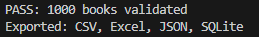
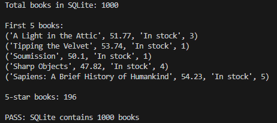

# Books to Scrape — Python ETL Pipeline

A personal Python project that extracts book information from Books to Scrape, cleans and validates the data, and exports the results to multiple formats.

## Features

- Extract book information from 50 web pages using Requests and BeautifulSoup
- Clean book prices and convert star ratings into numbers using Pandas
- Validate missing values, duplicate rows, prices, and ratings
- Export cleaned data to CSV, Excel, JSON, and SQLite
- Verify stored records using SQL queries

## Technologies Used

- Python
- Requests
- BeautifulSoup
- Pandas
- SQLite
- SQL

## Dataset

A successful pipeline run processed 1,000 books.

The dataset contains four columns:

| Column | Description |
|---|---|
| Title | Book title |
| Price | Price in GBP |
| Status | Stock availability |
| Rating | Star rating from 1 to 5 |

## Validation Results

- 1,000 books collected from 50 pages
- 20 books collected per page
- No missing values or duplicate rows detected
- Prices and ratings validated
- SQLite database verified to contain 1,000 records
- 196 books have a five-star rating

## Project Structure

- `scrape_v2.py` — Extracts, cleans, validates, and exports book data
- `config.py` — Configures the source URL and output settings
- `check_database.py` — Checks the SQLite database
- `requirements.txt` — Lists project dependencies

## Installation

```bash
pip install -r requirements.txt
```

## Usage

Run the ETL pipeline:

```bash
python scrape_v2.py
```

Check the SQLite database:

```bash
python check_database.py
```

## Output Formats

The pipeline produces these files in the `output_1000` directory:

- `books_data.csv`
- `books_data.xlsx`
- `books_data.json`
- `books.db`

## Data Source

Source: [Books to Scrape](https://books.toscrape.com/)

This is an independent personal learning project using a website designed for web scraping practice.

## Project Screenshots

### ETL Pipeline Execution



### SQLite Database Validation


